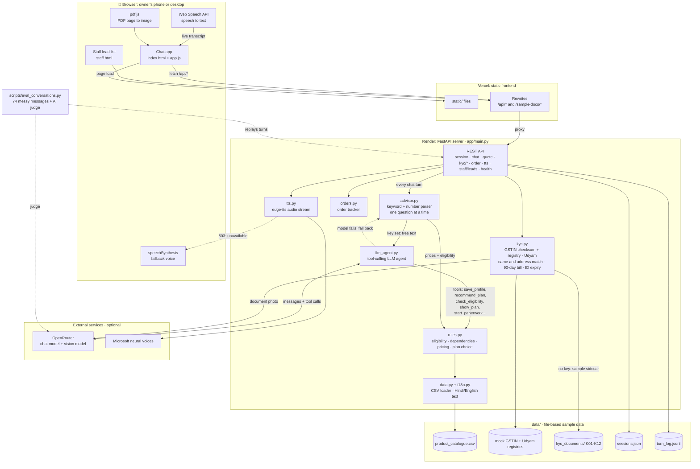

# Udyam Digital: working prototype

A mobile web app where a small-business owner chats with an advisor, gets the right plan and a clear price,
finishes KYC paperwork and tracks the order. No salesperson visit.

## Run it

```bash
pip install -r requirements.txt
python scripts/make_sample_data.py     # only if data/ is empty
python -m uvicorn app.main:app --port 8000
```

Open http://localhost:8000. On a wide screen you get the phone plus two side panels
(test cases on the left, what the code decided on the right). On a phone you get just the app,
and the ⋯ button opens the test cases.

Tests: `python -m pytest -q` (77 tests: PRD cases 1-12, applicants K01-K12, order path, memory, live plan, custom plans, LLM agent with the model mocked).

## What is real and what is a stand-in

| Piece | State |
|---|---|
| Rules engine, pricing, eligibility, dependencies | Real. Plain Python over `data/product_catalogue.csv`. |
| KYC checks (GSTIN format + checksum, registry, Udyam, names, address, 90-day bill, ID expiry) | Real. Code makes every pass/fail decision. |
| Advisor conversation | Keyword and number parser, one question at a time, Hindi + English. Works offline. |
| LLM (optional) | Set `OPENROUTER_API_KEY` in `.env`: free text the parser cannot read goes to an LLM that only extracts facts. Photos of documents go to a vision model. Without a key, the 4 sample documents are read from a sidecar file and any other photo is sent to "human review". |
| Case data | **Sample data**, generated by `scripts/make_sample_data.py` in the shape the PRD describes. Replace the CSVs in `data/` with the real ones. |
| WhatsApp, payment, DigiLocker, e-sign | Not built (per the PRD). |

The prices in the sample catalogue are chosen so every total in the PRD matches
(Clinic & Office Pro ₹3,742 + ₹1,500 setup, ₹4,241 with Cloud Backup, Dukaan Starter ₹1,497,
Multi-Store ₹5,195 per site, Factory Connect ₹16,025).

## Technical architecture



**How a chat turn flows:** the browser posts the owner's words (typed or transcribed) to `/api/chat`. The keyword advisor handles
buttons and messages it can parse. With an `OPENROUTER_API_KEY`, free text goes to the LLM agent, which may only change the
plan by calling tools backed by `rules.py`. Every rupee amount, eligibility decision and KYC pass/fail is computed in Python,
never by the model. If the model fails, the keyword advisor answers instead. The session is saved to `sessions.json` and
the turn is logged for the eval and debug view.

**Deployment:** Vercel serves `static/` and proxies `/api/*` and `/sample-docs/*` to the FastAPI service on Render
(`render.yaml`, health check `/api/health`). Run locally, the same FastAPI app serves both.

## Voice, live plan and memory

- **Voice chat:** tap the 🎤 button. Your words appear live in the message box as you speak, are sent when you pause,
  and the reply is spoken back, then it listens again. Tap Stop to end. Uses the browser's built-in speech
  (Chrome or Edge; Hindi needs a Hindi voice installed on the device). Typing still works any time.
- **Live plan:** the right panel (or the bar under the header on a phone) shows your plan building as you answer.
  It is marked **Estimate** and lists what it is assuming until you have answered everything.
- **Streamed replies:** replies appear word by word.
- **Memory:** the chat, your answers and your plan are saved (`data/sessions.json`), so a refresh or restart brings you back
  where you were. Ask "what did I tell you?" (or in Hindi) and it says it back.

## Build your own plan, a real conversation, and better voice

- **Build my own plan:** first chip in the greeting (or just say "I need 2 mobile lines and a website"). A "What do you need?"
  picker plus chat: every tap or request re-prices instantly, each item is explained in one sentence, and the advisor asks for
  city, team size and GST only to make sure you are only shown what you can buy. It suggests one related item at most, once,
  and stops after a no. Estimates are labelled until those facts are known.
- **Real conversation (needs a key):** with `OPENROUTER_API_KEY` in `.env`, the advisor becomes an LLM agent (`app/llm_agent.py`)
  that understands free speech, Hindi, English and Hinglish, remembers the whole chat, and calls the same rules engine as tools.
  Prices, eligibility and totals always come from tools. If the model call fails it falls back to the keyword advisor.
  Pick a model with `CHAT_MODEL` (needs tool calling; default `anthropic/claude-haiku-5.5`).
- **Voice:** replies are spoken with Microsoft neural voices (Hindi and English) through the `edge-tts` package, no key needed,
  internet required. If it is unreachable the browser's own best voice is used. The mic keeps listening through silence and pauses,
  sends after about 1.7 s of quiet, and only stops when you tap Stop.

## Catching bad answers without anyone reporting them

- `python scripts/eval_conversations.py` plays ~74 messy, realistic owner messages (mumbled voice transcripts, Hinglish, Hindi, Marathi,
  Tamil, vague, off-topic, angry, objections, corrections) against the real model, in parallel (about a minute). It flags any turn where
  the AI did not answer, a rupee amount did not come from a tool, the reply was in the wrong script, the paperwork did not open when
  asked, a reply was slow, or a second AI judge says the question was not answered. Report: `scripts/eval_report.json`.
- The running app logs every owner message to `data/turn_log.jsonl`. `GET /api/debug/turns?only_problems=true` shows the turns where the
  AI did not answer and the keyword fallback did.
- Chat models that "think" (like Claude Haiku 5.5) are called with thinking off: it used the whole token budget and left empty replies.

## Try it in 3 minutes

1. Left panel, test case **2**: the clinic gets ₹3,742. Switch **Cloud Backup** on: ₹4,241.
2. Tap **Continue to paperwork**, agree, open **Demo: try a sample applicant**, pick **K01**: everything fills and passes.
3. **Place my order**, then **Demo: simulate next step** to move the tracker.
4. Repeat with K02 to K12 to see each planted problem caught, with a plain "how to fix" sentence.
5. Toggle **हिं** in the header to switch to Hindi.
6. `/staff` shows the lead list with scores.

## Design

The UI follows the Stitch project "Udyam Digital Business Onboarding" (design system "Bharat Merchant Utility"):
Noto Sans, navy `#09244B`, saffron `#E65100`, emerald `#0D7A57`, Material Symbols icons (loaded from Google Fonts).
Only screens the app has logic for are built: chat, plan card and builder, live plan, paperwork, verification results,
order tracker, demo panels and the staff list.

## Folders

```
app/      main.py (API)  rules.py  advisor.py  kyc.py  orders.py  data.py  i18n.py  scenarios.py
static/   index.html  app.js  staff.html
          styles.css (tokens, shell, chat)  cards.css (plan, builder, tracker)
          kyc.css (paperwork)  harness.css (demo panels, live sheet)  staff.css
data/     catalogue + registries + kyc_documents/ (sample)
tests/    test_rules.py  test_advisor.py  test_kyc.py
```

Prototype shortcuts: sessions live in memory (restart clears them), no login, no database.
